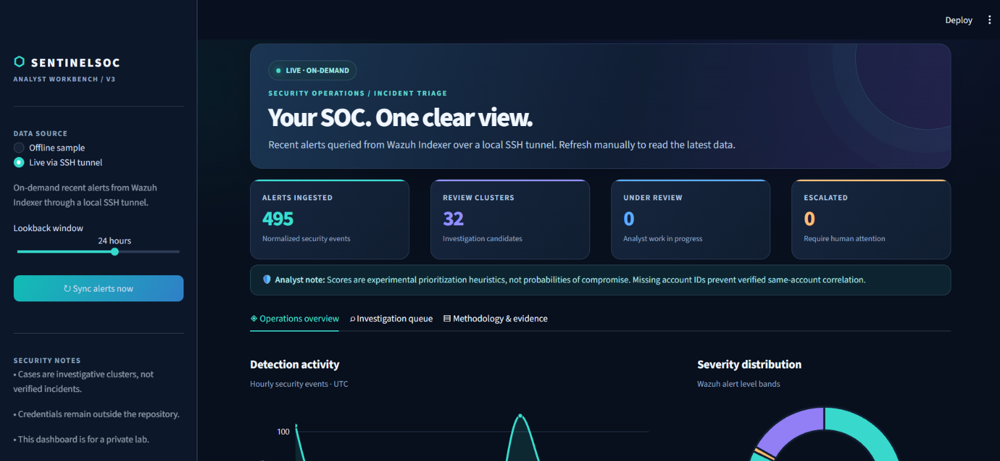
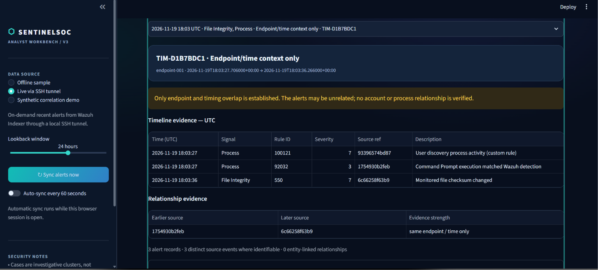
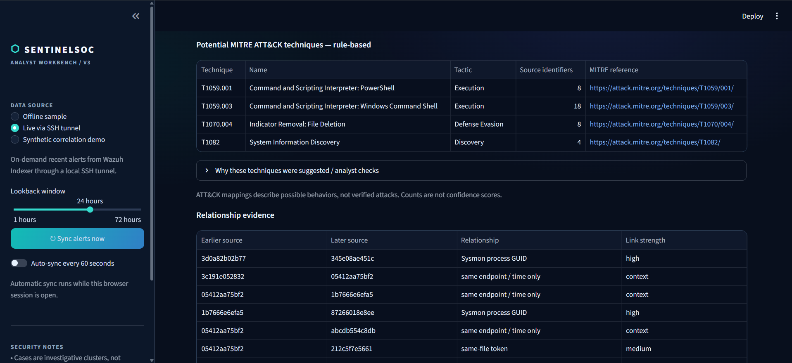
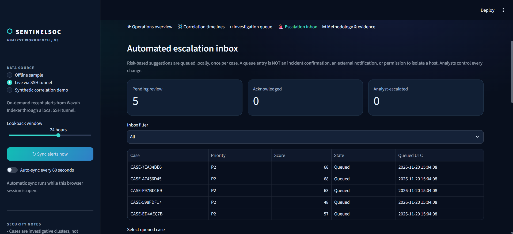
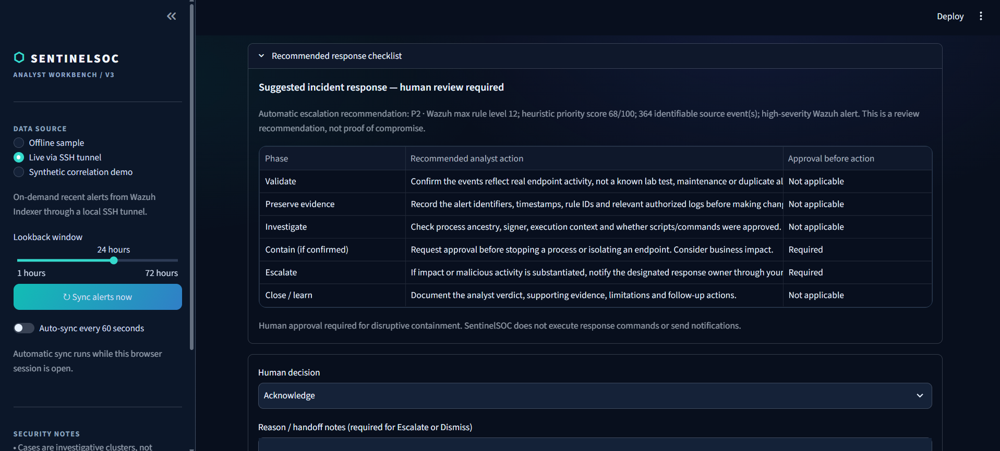
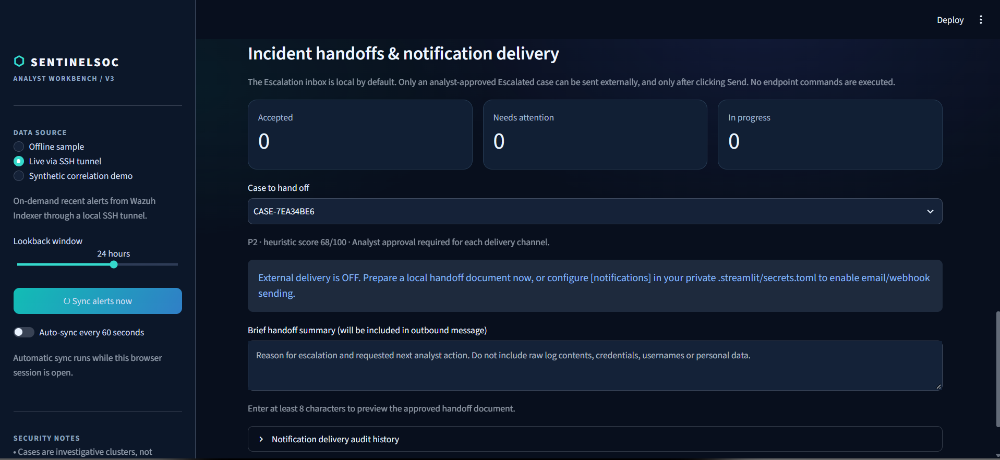

# SentinelSOC — Wazuh-Powered SOC Analyst Workbench

**A local Python/Streamlit SOC investigation and triage project.** SentinelSOC consumes Wazuh alerts, groups related events into investigation candidates, shows explainable risk scores, suggests potential MITRE ATT&CK techniques, and supports analyst-reviewed escalations and incident handoffs.

> **Lab project, not a production SIEM.** Correlated alerts are investigation candidates, not proof of compromise. Risk scores are heuristics, not compromise probabilities. This repository ships **synthetic sample data**, not real Wazuh logs.

## Features

- **Security operations overview:** activity visualization, alert severity and triage queue.
- **Live Wazuh integration:** read-only Indexer API access through a local SSH tunnel, TLS verification and privacy-limited alert fields.
- **Evidence-linked timelines:** process, account/file and temporal relationships with explicit confidence limits.
- **Investigation queue:** explainable risk scoring, analyst notes, case status history and downloadable reports.
- **MITRE ATT&CK suggestions:** rule-based mapping with analyst guidance; not automatic maliciousness claims.
- **Response and escalation:** recommended playbooks and locally audited human decisions in SQLite.
- **Incident handoffs:** downloadable summaries and optional **analyst-approved** SMTP/HTTPS webhook delivery with duplicate protection and a delivery audit.
- **Offline demos and tests:** synthetic fixtures, correlation demonstration and unit tests.

**Not included:** unattended 24/7 monitoring, automatic host containment, and verified real-world detection accuracy. The background monitoring and detection-validation upgrades are future work.


## Custom Wazuh Detection Rules

SentinelSOC includes custom XML detection rules developed
and tested in a controlled Wazuh lab environment.

- **Rule 100120:** Repeated failed login attempts (T1110)
- **Rule 100121:** User discovery using `whoami` (T1033)

The detections use Wazuh's rule engine and MITRE ATT&CK
mappings to support security monitoring and investigation.

[View Custom Detection Rules](wazuh-rules/README.md)

[View Rule Definitions](wazuh-rules/sentinelsoc_rules.xml)


## SentinelSOC — Screenshots

### Live SOC Dashboard


### Advanced Alert Correlation


### MITRE ATT&CK Mapping


### Automated Escalation Inbox


### Incident Response Recommendations


### Incident Handoff Report


### More Screenshots

[View all 16 detection and investigation screenshots](docs/screenshots/README.md)


## Architecture

```text
Windows lab endpoint (Sysmon / Windows Security / FIM)
                    |
               Wazuh Agent
                    |
           Wazuh Manager / Indexer
                    |
      Authenticated localhost SSH tunnel
                    |
   Read-only Indexer query + sanitization (live.py)
                    |
  Streamlit SOC Workbench (app.py)
   | Correlation / MITRE / Risk / Investigations
   | Analyst approval / Escalation / Handoff
                    |
        Local SQLite audit and reviews
         (private, never committed)
```

See [docs/ARCHITECTURE.md](docs/ARCHITECTURE.md).

## Quick start — offline demo

Prerequisites: Windows/macOS/Linux, compatible Python (test with your target environment), Git. Prefer a dedicated virtual environment.

### Windows PowerShell (VS Code terminal)

```powershell
py -m venv .venv
.\.venv\Scripts\Activate.ps1
python -m pip install --upgrade pip
python -m pip install -r requirements.txt
python -m unittest discover -s tests -v
python -m streamlit run app.py
```

Open `http://127.0.0.1:8501`, and choose **Offline sample** or **Synthetic correlation demo**. The samples are intentionally synthetic.

> If PowerShell prevents activating the environment, use `.\.venv\Scripts\python.exe` instead of `python` for installation, tests and Streamlit. Avoid changing machine-wide execution policies.

## Optional: live Wazuh lab integration

1. Configure a **read-only** Wazuh Indexer user (not an admin login). Keep the Indexer private.
2. Establish an SSH tunnel from your workstation to the Wazuh server, forwarding local port `9200` to the remote Indexer.
3. Create `.streamlit/secrets.toml` **locally** from `.streamlit/secrets.toml.example` and add only your own credentials and CA path. Never commit that file or the CA bundle.
4. Set `verify_tls = true` with the correct trusted CA, then run Streamlit and select **Live via SSH tunnel → Sync alerts now**.
5. Inspect the resulting incidents, evidence links and escalation decisions. **Do not** claim an alert is a confirmed attack without supporting analysis.

See [docs/SETUP_AND_SAFETY.md](docs/SETUP_AND_SAFETY.md) for commands and privacy notes. Sending email or webhooks is **disabled by default** and requires an approved handoff.

## Representative workflows

| Workflow | Output |
|---|---|
| Alert ingestion | Sanitized local alert records |
| Correlation | Timelines with high/medium/context relationships |
| Risk analysis | Heuristic scores and explanations |
| Threat analysis | Rule-based MITRE ATT&CK technique suggestions |
| Incident investigation | Analyst notes, decision history, downloadable reports |
| Escalation | Local inbox and approved handoff report |
| Optional notification | Analyst-approved delivery with audit records |

## Testing

```powershell
python -m unittest discover -s tests -v
python .\scripts\run_correlation_demo.py
python .\scripts\demo_response_escalation.py
python .\scripts\demo_notification_handoff.py
```

The included demo notification script uses a simulated provider; **it does not send email**. Real Indexer connectivity, SMTP/webhook delivery and detection accuracy require separate testing in an authorized lab.

## Documentation and evidence

- [Architecture](docs/ARCHITECTURE.md)
- [Setup and security](docs/SETUP_AND_SAFETY.md)
- [Screenshot checklist](docs/screenshots/README.md)
- [Custom Wazuh rule publishing checklist](wazuh-rules/README.md)
- [Demo scenarios and current limitations](docs/DEMO_AND_LIMITATIONS.md)

Add only **reviewed, redacted** screenshots and custom rules to their corresponding folders. Avoid publishing hostnames, credentials, real alert contents, network diagrams with personal IPs, or internal endpoint paths.


## SOC Investigation Case Studies

### Case Study 01 — Windows User Discovery Detection

Developed and validated a custom Wazuh detection rule for Windows user-discovery activity, then investigated the resulting alerts using SentinelSOC.

**Highlights:** Sysmon process analysis, custom Wazuh rule 100121, MITRE ATT&CK T1033/T1059.003, alert correlation, risk scoring, and documented analyst closure.

[Read the Full Investigation Case Study](docs/investigations/CASE_STUDY_01_USER_DISCOVERY.md)


## Project status

**Current release candidate:** functional lab workbench, with background monitoring and repeatable detection engineering planned. This is a learning and portfolio project; it has not undergone an independent security audit.

## License

A license has not yet been selected. Choose one before public collaboration if you want to grant reuse rights.
