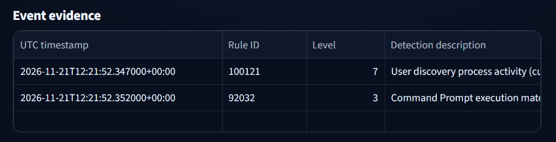
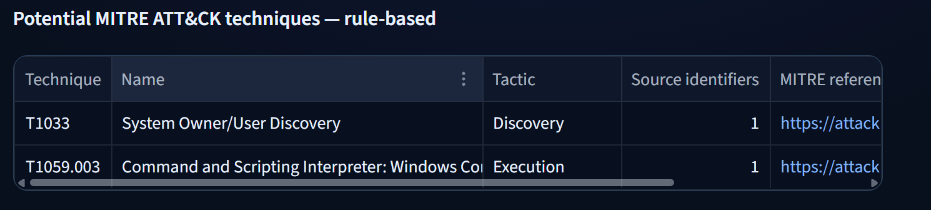
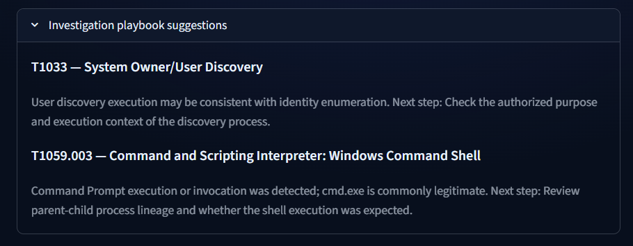
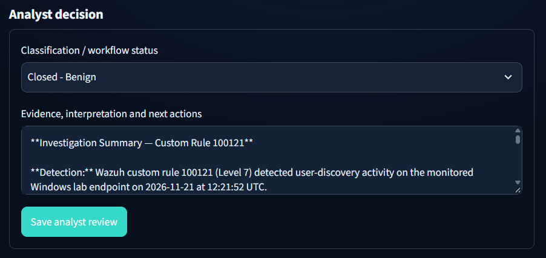
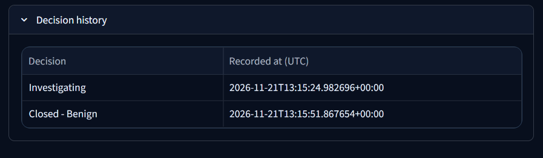

# SOC Investigation Case Study 01 — Windows User Discovery Detection

**Project:** SentinelSOC — SOC Analyst Workbench  
**Case ID:** CASE-49CB6C9E  
**Investigation Date:** November 21, 2026  
**Environment:** Windows Endpoint, Sysmon, Wazuh SIEM, SentinelSOC  
**Severity:** Wazuh Level 7  
**Final Classification:** Closed - Benign (Authorized Lab Activity)

---

## 1. Executive Summary

This case study documents the development, validation, and investigation of a custom Wazuh detection rule designed to identify Windows user-discovery activity.

During an authorized laboratory simulation, a PowerShell process launched Windows Command Prompt to execute `whoami`. Sysmon captured the process creation event, and custom Wazuh rule **100121** successfully generated an alert.

The detection was ingested and investigated through **SentinelSOC**, a Python-based SOC analyst workbench that provides alert correlation, MITRE ATT&CK mapping, heuristic prioritization, investigation playbooks, and analyst decision tracking.

Following investigation, the activity was classified as **Benign Positive**, as it originated from the authorized test rather than confirmed malicious activity.

## 2. Investigation Objectives

- Validate the functionality of custom Wazuh rule 100121.
- Confirm Windows Sysmon telemetry reaches Wazuh.
- Investigate the detection through SentinelSOC.
- Review process relationships and associated alerts.
- Map observed behavior to MITRE ATT&CK.
- Document an evidence-based analyst decision.

## 3. Lab Environment

| Component | Purpose |
|---|---|
| Windows endpoint | Monitored host used for controlled testing |
| Sysmon | Windows process creation telemetry |
| Wazuh Agent | Collects and forwards endpoint security events |
| Wazuh Manager | Processes events using detection rules |
| Wazuh Indexer | Stores searchable security alerts |
| SentinelSOC | Correlation, triage, investigation, and reporting |

SentinelSOC accessed the Wazuh Indexer through a local SSH tunnel with HTTPS certificate verification.

## 4. Detection Engineering

### Custom Detection Rule

**Rule ID:** 100121  
**Rule Level:** 7  
**Description:** SentinelSOC: User discovery command launched via PowerShell and CMD  
**MITRE ATT&CK:** T1033 — System Owner/User Discovery

The rule was designed to identify `whoami` execution within a Windows process creation event matching the relevant parent detection conditions.

The detection uses Wazuh rule chaining and command-line matching to recognize the targeted behavior.

**Rule configuration:** [View SentinelSOC custom Wazuh rules](../../wazuh-rules/sentinelsoc_rules.xml)

### Controlled Test

The following command was executed on the authorized Windows lab endpoint:

```powershell
powershell.exe -NoProfile -Command "cmd.exe /c whoami"
```

This test was intended to produce a PowerShell-to-Command-Prompt execution chain containing the `whoami` command.

## 5. Detection and Alert Validation

Sysmon Event ID 1 captured the process creation activity.

**Observed process relationship:**

```text
powershell.exe
    |
    +-- cmd.exe /c whoami
```

The Wazuh Manager generated a custom rule 100121 alert, confirming successful detection.

The resulting alerts were retrieved and displayed through SentinelSOC.

### Alert Evidence

| Timestamp (UTC) | Rule ID | Level | Description |
|---|---|---|---|
| 2026-11-21 12:21:52.347 | 100121 | 7 | User discovery process activity |
| 2026-11-21 12:21:52.352 | 92032 | 3 | Command Prompt execution |

These two alerts were associated with the investigation. Multiple alerts may represent related detections of the same underlying process activity rather than separate malicious actions.

### Evidence Screenshot



*Figure 1: SentinelSOC displaying custom rule 100121 and the supporting Command Prompt detection.*

## 6. MITRE ATT&CK Analysis

SentinelSOC suggested two MITRE ATT&CK techniques based on the detected events.

| Technique | Name | Tactic |
|---|---|---|
| T1033 | System Owner/User Discovery | Discovery |
| T1059.003 | Command and Scripting Interpreter: Windows Command Shell | Execution |

**T1033:** The `whoami` command can be used to identify the current user context. This behavior can occur during reconnaissance but is also common in legitimate administration.

**T1059.003:** The event included Command Prompt execution, represented by `cmd.exe`.

These mappings describe observed behavior and potential investigation relevance; they do not independently prove malicious intent.



*Figure 2: Rule-based MITRE ATT&CK technique mapping in SentinelSOC.*

## 7. Alert Correlation and Risk Assessment

SentinelSOC grouped the related alerts into investigation **CASE-49CB6C9E**.

**Investigation metrics:**

| Metric | Value |
|---|---|
| Source alerts | 2 |
| Maximum Wazuh rule level | 7 |
| Heuristic priority score | 41/100 |
| Automatic escalation | Routine review — not queued |

The experimental heuristic score was calculated using:

- Highest Wazuh rule level: +28
- Additional related alerts: +3
- Original custom detection: +10

**Total: 41/100**

This value is a prioritization aid, not a probability of compromise.

SentinelSOC recommended routine human review rather than automatic escalation.

## 8. Investigation Playbook

SentinelSOC provided investigation guidance for both MITRE techniques and a structured response checklist.

The suggested workflow included validating the alert, preserving evidence, reviewing process ancestry, considering containment only if justified, and documenting the final decision.

The investigation focused on determining whether the detected activity represented legitimate testing or unauthorized execution.



*Figure 3: Investigation playbook suggestions and human-reviewed incident response workflow.*

## 9. Analyst Investigation and Findings

The investigation reviewed the following evidence:

1. Wazuh custom rule 100121 successfully generated a Level 7 alert.
2. Sysmon Event ID 1 identified the process creation activity.
3. PowerShell launched Command Prompt to execute `whoami`.
4. A related Wazuh rule 92032 alert was associated with the investigation.
5. SentinelSOC identified relevant MITRE ATT&CK techniques.
6. The execution was confirmed as part of the authorized laboratory simulation.

The evidence demonstrated that the custom detection was functioning as intended.

No evidence in the reviewed alerts established unauthorized access, malicious intent, or a confirmed compromise.

## 10. Analyst Decision and Case Closure

**Initial workflow status:** Investigating  
**Final classification:** Closed - Benign  
**Analyst verdict:** Benign Positive — Authorized Lab Activity

The detected process execution was genuine and matched the custom rule conditions. However, it was deliberately generated as part of an authorized security test.

Because the activity was expected and no malicious behavior was established, no containment or escalation was required.

The analyst decision was recorded through SentinelSOC's review workflow.



*Figure 4: Analyst review and case disposition.*



*Figure 5: Recorded analyst investigation history.*

## 11. Limitations

- This was a controlled laboratory simulation, not a real-world security incident.
- The report analyzes a selected subset of alerts rather than all endpoint activity.
- Related rule matches can represent the same underlying process execution.
- MITRE ATT&CK mapping is based on observed behavior and detection rules.
- The heuristic priority score does not measure the likelihood of compromise.
- Detection of `whoami` alone is insufficient to determine malicious intent.

## 12. Outcome and Skills Demonstrated

The investigation successfully validated a custom Wazuh detection rule and demonstrated an end-to-end SOC workflow.

**Skills demonstrated:**

- Custom SIEM detection rule development
- Windows Sysmon log analysis
- Wazuh alert validation
- Process execution and parent-child relationship analysis
- Alert correlation and prioritization
- MITRE ATT&CK mapping
- SOC incident triage
- Evidence-based analyst decision-making
- Investigation reporting and documentation

## 13. Conclusion

This case study demonstrates how custom detection engineering can be integrated into a practical SOC investigation workflow.

Custom rule 100121 successfully identified the targeted Windows user-discovery behavior, and SentinelSOC supported the subsequent analysis through alert correlation, risk prioritization, ATT&CK mapping, and analyst review.

The investigation concluded with a documented benign classification, demonstrating the importance of distinguishing a successful security detection from an actual security incident.