# SentinelSOC — Detection & Investigation Screenshots

Screenshots captured during security monitoring, detection validation, and incident investigation in the SentinelSOC lab environment.

## 1. Wazuh & Windows Monitoring

### Windows Endpoint Connected
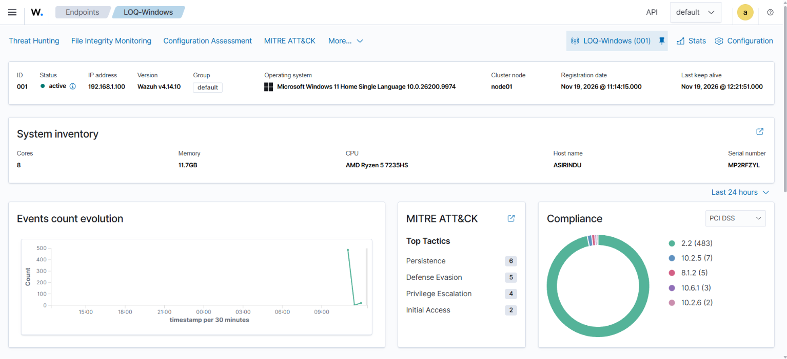

### Windows Failed Login Detection
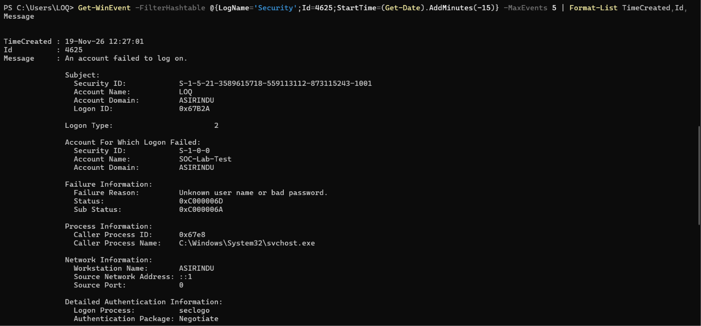

### Wazuh Authentication Alert
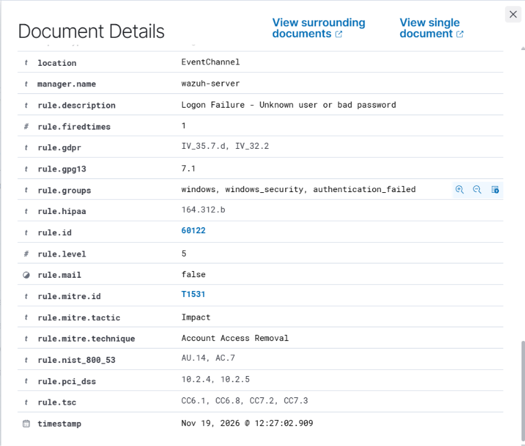

### File Integrity Monitoring
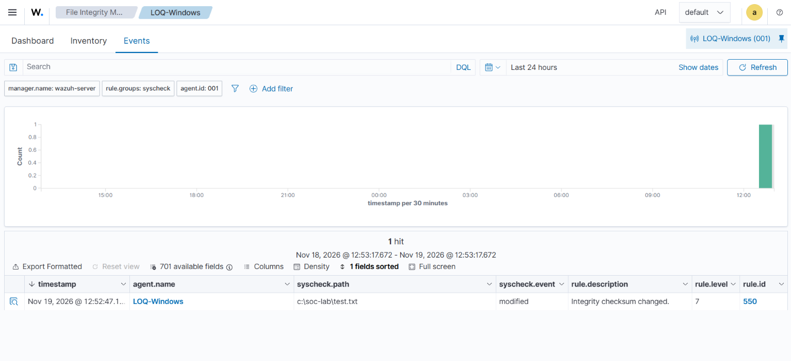

## 2. Custom Security Detections

### Custom Detection Rule
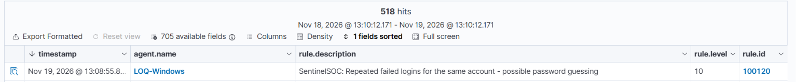

### Additional Custom Detection
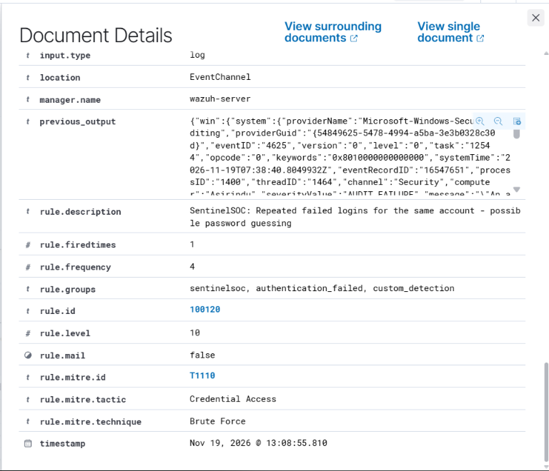

### Sysmon Process Creation
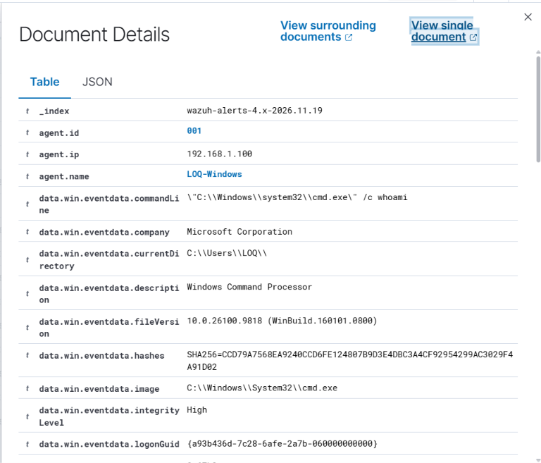

### Custom Sysmon Detection
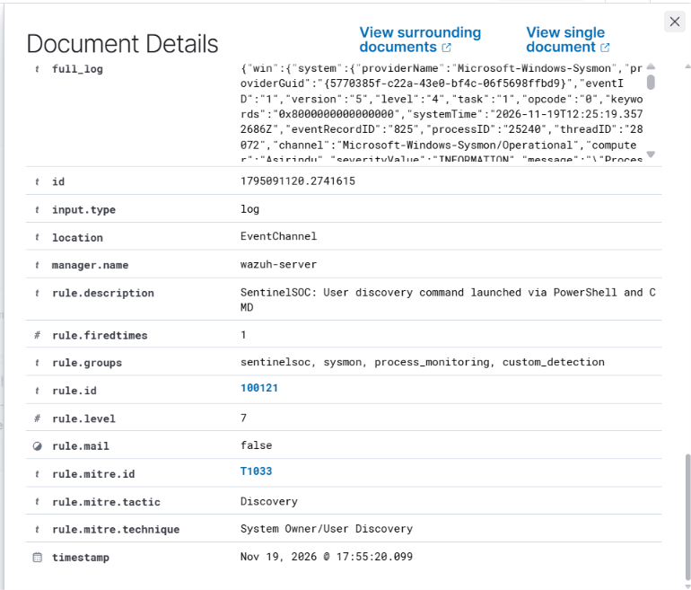

## 3. SentinelSOC Analyst Workbench

### Live SOC Dashboard
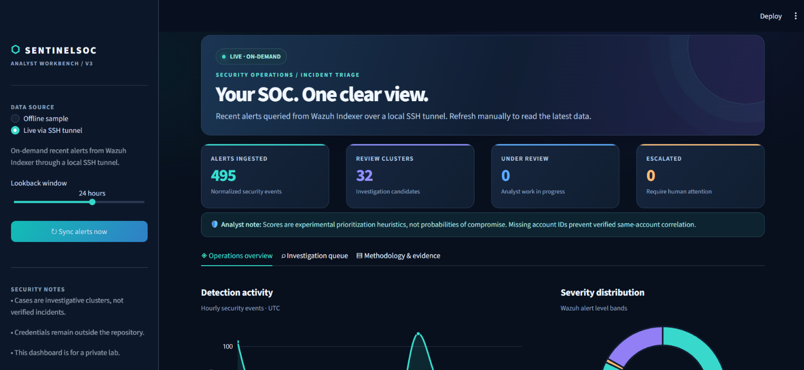

### Synthetic Correlation Timeline
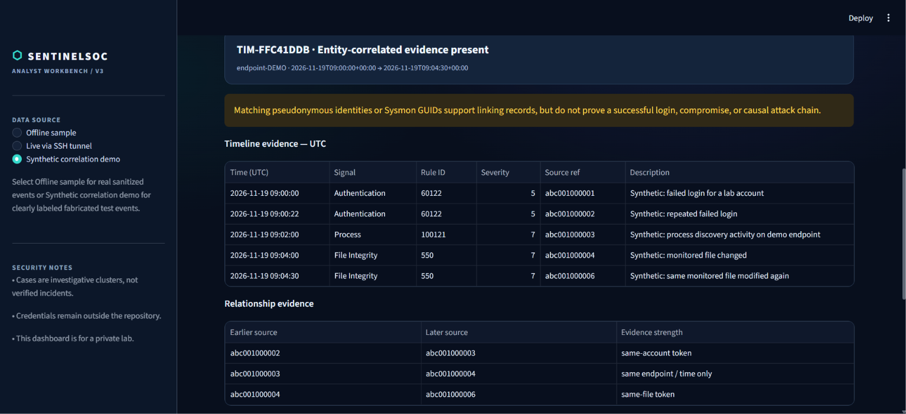

### Live Alert Correlation
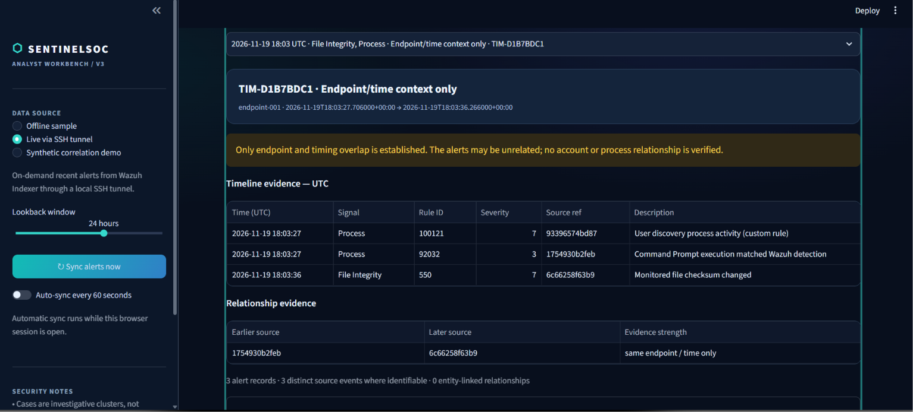

### File Who-Data Attribution
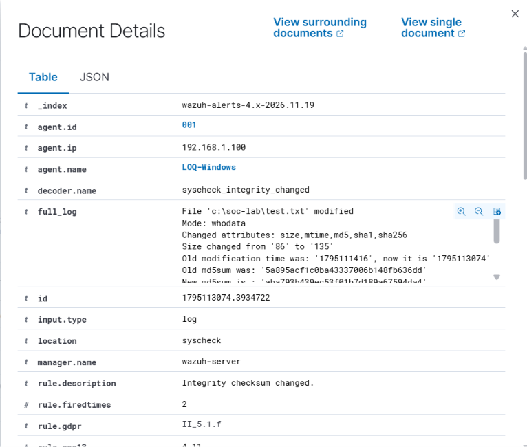

## 4. Advanced SOC Features

### MITRE ATT&CK Mapping
SentinelSOC maps detection alerts to potential MITRE ATT&CK techniques.

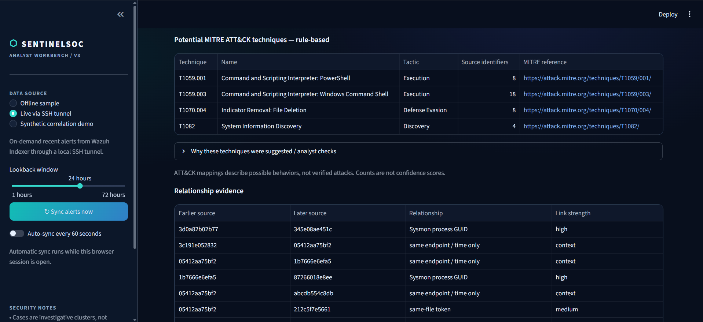

### Automated Escalation Inbox
Risk-based incident prioritization and analyst-controlled escalation.

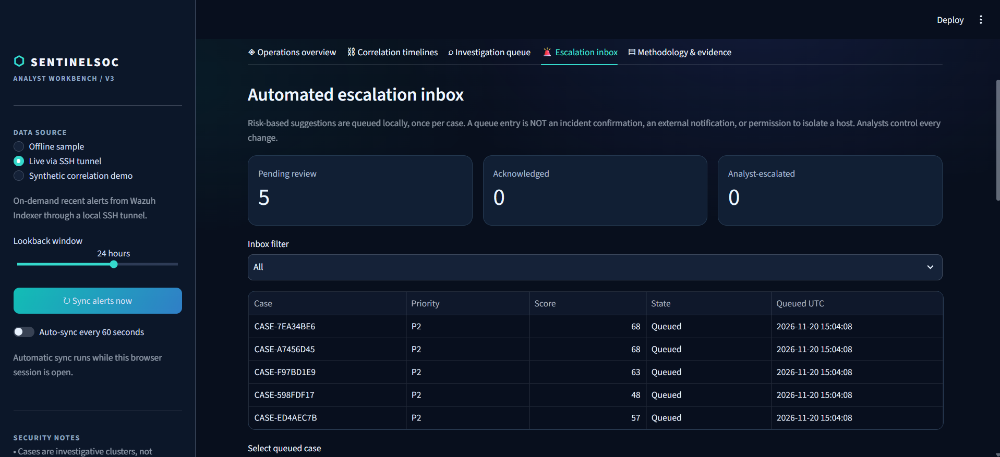

### Incident Response Recommendations
Investigation, evidence preservation, containment and escalation guidance.

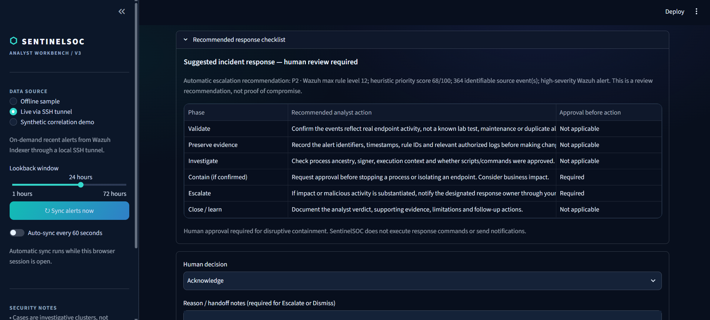

### Incident Handoff Reports
Downloadable investigation reports containing case details and analyst findings.

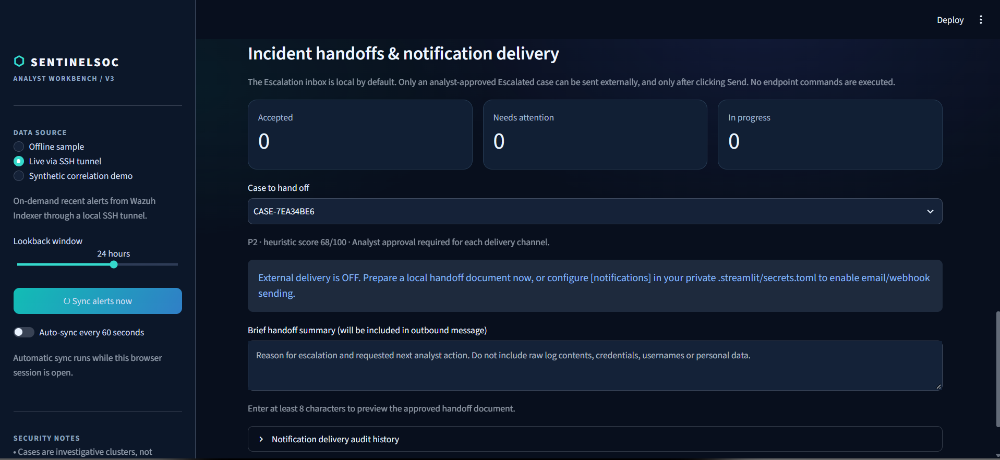

---

**Note:** These screenshots document controlled laboratory activities. Alerts and ATT&CK mappings do not necessarily indicate confirmed malicious activity.
